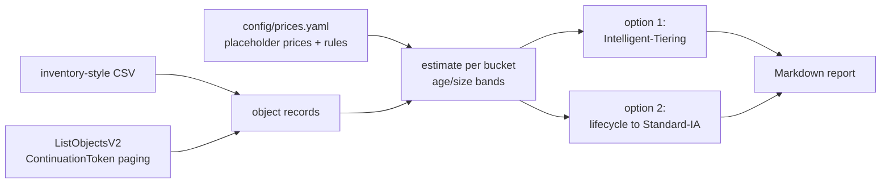

# S3 Intelligent-Tiering and lifecycle savings report

A read-only Python job that looks at the objects in your S3 buckets, groups
them by age and size, and estimates how much you would save per month by
moving STANDARD objects to **Intelligent-Tiering** or by adding a
**lifecycle rule to Standard-IA**. Output is a Markdown report.

> **Status:** S3 is implemented and unit tested (29 tests) with a CSV
> fixture and a hand-written fake `ListObjectsV2` client, including bad
> input, bad prices, and boundary cases for the 30-day and 128 KiB rules.
> It has **not** been run against a real account. **Azure Blob is not
> implemented.** The scheduler is described below but **not built**.
> **All prices are illustrative placeholders**, not current AWS prices.

## Problem

> Develop a scheduled job that calculates and reports on S3
> Intelligent-Tiering / Azure Blob lifecycle savings opportunities.

Why it matters: objects in S3 Standard that nobody reads are still billed at
the Standard rate. Estimating the saving first shows whether
Intelligent-Tiering or a lifecycle rule is worth turning on, and for which
buckets.

## How it works



Only objects already in `STANDARD` are considered; others are counted as
skipped. Each one is put in a band:

| Band | Rule (defaults) |
|---|---|
| `small` | under 128 KiB |
| `recent` | younger than 30 days |
| `cooling` | 30 to 89 days |
| `cold` | 90 days or older |

Then two options are priced from `config/prices.yaml`:

- **Intelligent-Tiering:** `recent` stays at the frequent-access price,
  `cooling` gets the infrequent price, `cold` gets the archive-instant
  price, and each object pays the monitoring fee. `small` objects stay at
  the frequent price with no fee, so they save nothing.
- **Lifecycle to Standard-IA:** objects at least 30 days old and at least
  128 KiB are priced at Standard-IA. Everything else stays at STANDARD.

The report also shows a one-time cost for lifecycle transition requests.
Money is handled with `Decimal`.

### Rules that come from AWS behaviour (re-verify)

These are coded as config values or checks and labelled in the report.
Check them against current S3 documentation before relying on them:

- Intelligent-Tiering does not monitor or auto-tier objects under 128 KiB.
- Standard-IA bills objects smaller than 128 KiB as 128 KiB.
- Lifecycle cannot move objects to Standard-IA until they are 30 days old
  (`ia_transition_after_days` below 30 is rejected).
- Standard-IA has a 30-day minimum storage charge. This is **not**
  modelled because we can't know when objects will be deleted.

## Usage

```bash
python -m pip install -r requirements-dev.txt
python -m ruff check .
python -m ruff format --check .
python -m pytest -q

# From an inventory-style CSV (header row required)
python -m s3savings --inventory tests/fixtures/inventory.csv --as-of 2026-11-20

# Live listing (needs s3:ListBucket on each bucket)
python -m s3savings --bucket logs-example-com --bucket media-example-com --output savings.md

# Your own prices
python -m s3savings --inventory objects.csv --prices my-prices.yaml
```

CSV columns: `bucket,key,size,last_modified_date,storage_class`, with
timestamps carrying a UTC offset (`2026-11-10T03:00:00Z`). Real S3
Inventory CSV files have no header row and their column order comes from
the manifest, so add the header (or adapt `read_inventory_csv`) first.

Exit code is `1` on bad CSV rows (the line number is named), bad price
files, objects dated after `--as-of`, empty input, or API errors. No
partial report is written.

## Scheduling it (not built here)

The job is a plain CLI, so any scheduler works. Pick the simplest that
fits:

- **cron** on an existing host:
  `0 6 * * 1 cd /opt/s3savings && python -m s3savings --inventory /data/latest.csv --output /reports/s3-$(date +\%F).md`
- **EventBridge Scheduler** running an ECS Fargate task (or a Lambda for
  small buckets) once a week, with the report written to S3 or sent by
  SNS/email.
- For large buckets, turn on **S3 Inventory** (daily or weekly CSV) and
  point the job at the inventory file instead of listing live; listing
  millions of objects is slow and costs one request per 1,000 objects.

## Limits

- S3 only. Azure Blob lifecycle is not implemented.
- Age comes from `LastModified`, not last access. An old object that is
  read every day would not actually tier down, so savings are an **upper
  bound**. S3 Storage Lens or server access logs give real access data.
- Retrieval fees, Standard-IA minimum storage charges on early deletes,
  Glacier classes, versioned objects, and multipart parts are not modelled.
- Intelligent-Tiering optional archive tiers are not modelled.
- Live mode reads the whole bucket into memory one object at a time;
  fine for thousands of objects, use inventory for millions.

## Security notes

- Read-only. The only API call is `ListObjectsV2`; no lifecycle rule or
  storage class is changed.
- No credentials in code; boto3 uses the standard credential chain.
- Object keys can be sensitive. The report only prints bucket names and
  totals, never keys.

## Idempotency

Nothing is changed, so repeated runs are safe. With the same input and
`--as-of` date the report is identical.

## Layout

```
s3savings/sources.py    CSV reader and paged ListObjectsV2 reader
s3savings/prices.py     price table loader and rule checks
s3savings/estimate.py   bands and per-bucket savings
s3savings/report.py     Markdown
s3savings/cli.py        arguments and exit codes
config/prices.yaml      illustrative placeholder prices
```
